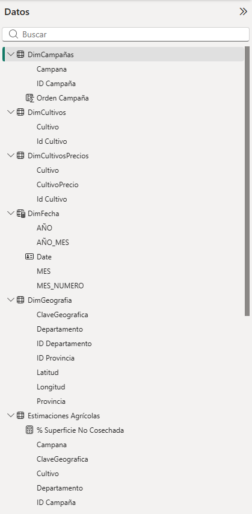
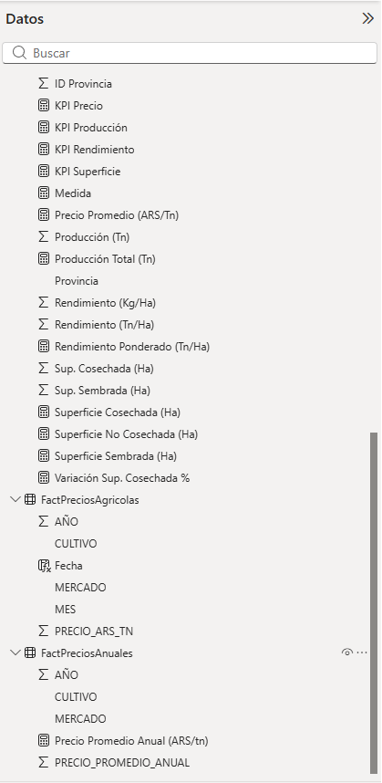
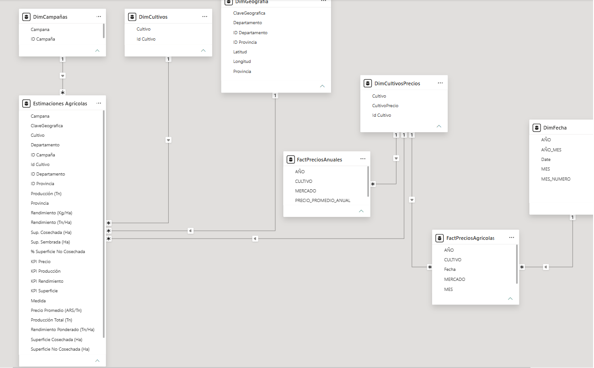
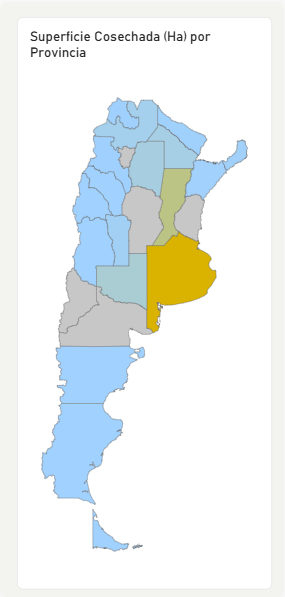

# Rentabilidad cultivos Argentina


## Diplomatura en Ciencia de Datos orientada al Agro

**Proyecto:** Análisis de la evolución productiva y económica de los principales cultivos agrícolas de Argentina.

---

## 1. Objetivo del proyecto

Analizar la evolución de la producción, los rendimientos y los precios de los principales cultivos agrícolas de Argentina, con el propósito de generar información que permita comprender su comportamiento productivo y económico.

### Pregunta de negocio

> ¿Cómo evolucionó la rentabilidad por hectárea de los principales cultivos agrícolas en Argentina durante las últimas campañas, y qué incidencia tuvieron las variaciones de los precios, los costos de producción y los rendimientos sobre los resultados económicos?


### Cultivos seleccionados

- Soja total
- Maíz
- Trigo total
- Girasol
- Sorgo
- Lino
- Cebada forrajera

---

## 2. Fuentes de datos

### 2.1. MAGyP – Estimaciones Agrícolas

Fuente: https://datosestimaciones.magyp.gob.ar/reportes.php?reporte=Estimaciones

Contiene información productiva por provincia, departamento, cultivo y campaña.

Variables principales:
- Provincia y departamento.
- Cultivo.
- Campaña agrícola.
- Superficie sembrada.
- Superficie cosechada.
- Producción en toneladas.
- Rendimiento en kg/ha.

### 2.2. MAGyP – Históricos de precios internos de granos

Fuente: https://magyp.gob.ar/new/0-0/programas/dma/dma/historicos.php

Archivo Excel oficial: *Históricos de la Evolución de los Precios Internos de los Principales Granos*.

Características:
- Precios expresados en pesos argentinos por tonelada (ARS/tn).
- Frecuencia mensual.
- Cobertura histórica desde 1996 hasta septiembre de 2026.
- Mercados: Dársena, Rosario, Bahía Blanca, Córdoba y Quequén.
- Cultivos: soja, maíz, trigo, girasol, sorgo, lino y cebada forrajera.

Los registros `S/C` y vacíos se consideran datos faltantes, no valores cero.

### 2.3. Geografía para el mapa

Geometría de provincias del Servicio de Normalización de Datos Geográficos (IGN, datos.gob.ar). Se usó para el mapa de formas y para obtener las coordenadas de referencia de cada provincia.

### 2.4. Fuentes de costos

Se identificaron fuentes complementarias para incorporar costos y márgenes agrícolas:

- MAGyP: https://www.magyp.gob.ar/sitio/areas/analisis_economico/margenes/
- INTA Pergamino: informes de márgenes brutos agrícolas.
- INTA-CIEP: indicadores sintéticos de evolución de costos, ingresos y márgenes.

Se deberá definir una cobertura geográfica y temporal comparable antes de integrar estos datos.

---

## 3. Procedimiento

### 3.1. Estimaciones agrícolas (tabla de hechos)

1. **Importación** del archivo de estimaciones.
2. **Encabezados:** se promovió la primera fila como encabezados.
3. **Tipos de datos:** se fijaron los tipos numéricos para superficie, producción y rendimiento.
4. **Rendimiento en tn/ha:** la fuente informa en kg/ha, así que se creó `Rendimiento (Tn/Ha)` dividiendo por 1.000.
5. **Calidad de datos:** se revisaron nulos, valores negativos y duplicados. Los valores `S/C` se trataron como faltantes.
6. **Clave geográfica:** se creó `ClaveGeografica` concatenando el identificador de provincia y el de departamento, con guion:

   ```
   Text.From([ID Provincia]) & "-" & Text.From([ID Departamento])
   ```

   Esta clave permite relacionar la producción con la dimensión geográfica sin depender de los nombres de departamento, que tienen variantes de escritura.

7. **Medidas de producción:** se crearon las medidas de sección 4.8.

### 3.2. Precios mensuales (tabla de hechos)

1. **Importación** de las dos hojas del Excel oficial del MAGyP:
   - `Precios_Soja_Girasol_Lino`
   - `Precios_Trigo_Maiz_Sorgo_Cebada_Largo`
2. **De formato ancho a largo:** se usó la anulación de dinamización de columnas, para que cada fila sea un año, mes, cultivo, mercado y precio.
3. **Normalización:** se unificaron nombres de cultivos y mercados, y se corrigieron inconsistencias de escritura entre hojas.
4. **Anexado:** las dos consultas se combinaron en `FactPreciosAgricolas`, con las columnas `AÑO`, `MES`, `CULTIVO`, `MERCADO` y `PRECIO_ARS_TN`.
5. **Revisión de calidad:** se verificaron siete categorías de cultivos, cinco mercados, 100 % de valores válidos y ausencia de errores o vacíos en la consulta final.
6. **Columna de fecha:** se creó `Fecha` en `FactPreciosAgricolas` a partir del año y el mes de cada registro.

### 3.3. Calendario

Se creó `DimFecha` con fechas desde enero de 1996 hasta septiembre de 2026, con las columnas `Date`, `AÑO`, `MES_NUMERO`, `MES` y `AÑO_MES`. Se configuró el orden de los meses y se marcó la tabla como tabla de fechas.

Relación: `DimFecha[Date]` → `FactPreciosAgricolas[Fecha]`, uno a varios (1:*), filtro en una sola dirección y activa.

### 3.4. Precios promedio anuales (tabla de hechos)

1. Se creó una consulta por referencia de `FactPreciosAgricolas`, llamada `FactPreciosAnuales`.
2. Se eliminó la columna `MES`, porque el objetivo es resumir por año.
3. Se usó **Agrupar por** con `AÑO`, `CULTIVO` y `MERCADO`, y la operación de **promedio** sobre `PRECIO_ARS_TN`, con el resultado en `PRECIO_PROMEDIO_ANUAL`.

La tabla resultante tiene una fila por cada combinación de año, cultivo y mercado.


<div style="display: flex; gap: 15px;">
  
  
</div>

### 3.5. Dimensiones

- **DimCampañas:** lista de campañas. Se agregó `Orden Campaña`, que toma el año de inicio de la campaña (por ejemplo, 2015 para 2015/16), para ordenar cronológicamente. Sin esa columna, el gráfico de campañas aparecía desordenado (1979/80 antes que 1978/79).
- **DimCultivos:** catálogo de cultivos de la fuente productiva.
- **DimCultivosPrecios:** consulta por referencia de `DimCultivos`, con la columna `CultivoPrecio` para relacionar los nombres de las dos fuentes.

| Cultivo productivo | Cultivo de precios |
|---|---|
| Soja total | SOJA |
| Maíz | MAIZ |
| Girasol | GIRASOL |
| Lino | LINO |
| Sorgo | SORGO |
| Trigo total | TRIGO |
| Cebada forrajera | CEBADA_FORRAJERIA |

Se verificó que los siete identificadores de cultivo sean únicos.

- **DimGeografia:** provincia y departamento, con `ClaveGeografica`. Luego se le incorporaron latitud y longitud de cada provincia (ver sección 3.7).

### 3.6. Relaciones del modelo

Esquema de estrella. Todas las relaciones son uno a varios (1:*), con filtro en una sola dirección y activas.

| Desde | Hacia |
|---|---|
| DimCampañas[ID Campaña] | Estimaciones Agrícolas[ID Campaña] |
| DimCultivosPrecios[Id Cultivo] | Estimaciones Agrícolas[Id Cultivo] |
| DimGeografia[ClaveGeografica] | Estimaciones Agrícolas[ClaveGeografica] |
| DimCultivosPrecios[CultivoPrecio] | FactPreciosAgricolas[CULTIVO] |
| DimCultivosPrecios[CultivoPrecio] | FactPreciosAnuales[CULTIVO] |
| DimFecha[Date] | FactPreciosAgricolas[Fecha] |

Decisiones de modelado:
- Se eliminó la relación automática entre `DimCultivosPrecios` y `DimCultivos`, para evitar rutas ambiguas.
- `DimCultivosPrecios` es la única tabla de cultivos usada en segmentadores y leyendas de precios. Así, la selección de un cultivo filtra tanto la producción como los precios.
- La tabla de centroides no tiene relación propia. Sus coordenadas se incorporaron a `DimGeografia`, porque una relación adicional generaba una ruta ambigua hacia las estimaciones.



### 3.7. Mapa de provincias

1. **Limpieza del archivo:** la geometría de "Tierra del Fuego, Antártida e Islas del Atlántico Sur" incluía polígonos antárticos que estiraban el mapa. Se recortaron, y se quitaron Malvinas y las islas del Atlántico Sur.
2. **Propiedad de nombre:** el mapa de formas de Power BI busca las provincias por la propiedad `name`. Se agregó con el mismo valor de `nombre`. Sin esa propiedad, el mapa aparecía sin color.
3. **Carga:** se cargó como mapa personalizado, porque por defecto Power BI muestra Estados Unidos.
4. **Coordenadas para el mapa de burbujas:** se tomaron los centroides del mismo archivo, se pasaron a una tabla con provincia, latitud y longitud, y se combinaron con `DimGeografia` solo por la columna Provincia.
5. **Corrección de formato:** la configuración regional leía el punto decimal como separador de miles. Se corrigieron dividiendo por 1.000.000. Después, algunas longitudes habían perdido un dígito; se corrigieron con una columna personalizada, ya que las longitudes válidas de Argentina son menores a -50:

   ```
   if [Longitud] > -10 then [Longitud] * 10 else [Longitud]
   ```

---

## 4. Medidas DAX

```dax
Producción Total (Tn) =
SUM('Estimaciones Agrícolas'[Producción (Tn)])
```

```dax
Superficie Cosechada (Ha) =
SUM('Estimaciones Agrícolas'[Sup. Cosechada (Ha)])
```

```dax
Superficie Sembrada (Ha) =
SUM('Estimaciones Agrícolas'[Sup. Sembrada (Ha)])
```

```dax
Rendimiento Ponderado (Tn/Ha) =
DIVIDE(
    [Producción Total (Tn)],
    [Superficie Cosechada (Ha)],
    0
)
```

```dax
Superficie No Cosechada (Ha) =
[Superficie Sembrada (Ha)] - [Superficie Cosechada (Ha)]
```

```dax
% Superficie No Cosechada =
DIVIDE(
    [Superficie No Cosechada (Ha)],
    [Superficie Sembrada (Ha)],
    0
)
```

```dax
Precio Promedio Anual (ARS/tn) =
AVERAGE(FactPreciosAnuales[PRECIO_PROMEDIO_ANUAL])
```

Tarjetas de resumen. Solo muestran valor cuando hay una única campaña seleccionada; con varias o con "Todas" muestran un guion, para no presentar sumas de campañas distintas como si fueran un solo período:

```dax
KPI Producción =
IF(
    HASONEVALUE(DimCampañas[Campana]),
    FORMAT([Producción Total (Tn)], "#,##0"),
    "—"
)
```

La misma lógica se aplicó a superficie, rendimiento y precio.

Variación de superficie cosechada entre dos campañas, para el mapa:

```dax
Variación Sup. Cosechada % =
VAR Actual =
    CALCULATE(
        [Superficie Cosechada (Ha)],
        'DimCampañas'[Campana] = "2025/26"
    )
VAR Base =
    CALCULATE(
        [Superficie Cosechada (Ha)],
        'DimCampañas'[Campana] = "2015/16"
    )
RETURN
    DIVIDE(Actual - Base, Base)
```

---

## 5. Dashboard de Power BI

Estructura del informe:

| Página | Contenido | Estado |
|---|---|---|
| 1. Panorama | KPI de producción, superficie, rendimiento y precio; producción por cultivo y por provincia; rendimiento por cultivo | Terminada |
| 2. Análisis productivo | Mapa de superficie sembrada por provincia según campaña, gráfico de participación por cultivo, rendimiento por campaña |
| 3. Evolución de precios | Precio anual por cultivo, precio por mercado, gráfico de líneas con selección de cultivo | En revisión |

Componentes principales:

- **Tabla resumen por cultivo:** producción, superficie cosechada, rendimiento ponderado y precio promedio.
- **Gráfico de barras por mercado:** precio promedio anual por mercado (Córdoba, Rosario, Quequén, Bahía Blanca y Dársena). Se quitó la suma de años del gráfico, porque sumar años no tiene sentido analítico.
- **Indicadores KPI:** producción total y rendimiento ponderado, con valor solo con una campaña seleccionada.
- **Mapa de formas:** superficie sembrada por provincia, según la campaña elegida, con la información de producción, superficie cosechada y rendimiento en el tooltip.
- **Mapa de burbujas:** producción por provincia, ubicada con latitud y longitud.
- **Gráfico de líneas de evolución anual:** eje X con `AÑO`, eje Y con el precio promedio, leyenda por cultivo. Las unidades del eje Y están en "Ninguno" para mostrar los valores completos en ARS/tn.
- **Segmentadores:** campaña (selección única), cultivo y mercado. El cultivo se toma de `DimCultivosPrecios` en todas las páginas.

---

## 6. Decisiones metodológicas y advertencias

1. **Precios nominales:** los precios originales son nominales. Para estudiar la evolución real será necesario deflactarlos con un índice apropiado.
2. **Promedio anual:** se calcula sobre los meses disponibles para cada cultivo y mercado.
3. **Mercado de referencia:** Rosario. Un promedio de mercados no representa necesariamente un precio nacional ponderado; los cinco mercados se comparan con un solo cultivo para verificar que se muevan de forma similar.
4. **Rendimiento:** producción total dividida por superficie cosechada, sin promediar rendimientos individuales.
5. **Campaña y año calendario:** la campaña agrícola no equivale al año calendario. Los precios se resumen por año, y la producción por campaña.
6. **Valores S/C:** se tratan como datos faltantes, no como cero.
7. **Superficie:** cosechada para el rendimiento, y sembrada para la distribución del área entre provincias.
8. **Soja:** se usa "soja total", porque es la categoría con precio en la fuente.
9. **Costos:** no deben compararse costos regionales con producción nacional sin aclarar las diferencias geográficas.
10. **Margen bruto:** no equivale a la ganancia neta.
11. **Años:** no deben sumarse como si fueran cantidades económicas.

---

## 7. Problemas encontrados y cómo se resolvieron

| Problema | Causa | Solución |
|---|---|---|
| El eje Y mostraba "recuento" en lugar de toneladas por hectárea | Se arrastró la columna en lugar de la medida | Usar la medida `Rendimiento Ponderado (Tn/Ha)` y dejar la columna en "No resumir" |
| Campañas desordenadas | El orden alfabético no es cronológico | Columna `Orden Campaña` |
| Cebada forrajera sin precios | El nombre en la fuente (`CEBADA_FORRAJERIA`) no coincidía | Corregir la homologación en `DimCultivosPrecios` |
| Leyenda de precios con más de 40 cultivos y valores repetidos | La leyenda tomaba la columna de la tabla de estimaciones | Usar `DimCultivosPrecios[Cultivo]` |
| Segmentador de cultivo sin efecto en los precios | Estaba conectado a la tabla de estimaciones | Usar `DimCultivosPrecios[Cultivo]` en todas las páginas |
| Torta con cultivos ajenos (soja 1ra, avena, etc.) | Se tomaba de la tabla de estimaciones | Usar `DimCultivosPrecios` y quitar valores vacíos |
| Etiqueta "Primera fecha" en el pozo de campos | Es el nombre por defecto de la agregación First | Se verificó que el tooltip muestra la provincia; la etiqueta del pozo se mantiene |
| Mapa de formas sin color | Power BI no encontraba los nombres de provincia | Agregar la propiedad `name` al archivo |
| Mapa estirado hacia la Antártida | Polígonos antárticos en la geometría | Recortar esos polígonos |
| Mapa de Estados Unidos por defecto | Mapa genérico de Power BI | Cargar el mapa personalizado de provincias |
| Coordenadas con valores enormes | Configuración regional con punto como separador de miles | Dividir por 1.000.000 |
| Longitudes con un dígito de menos | Error en el valor de origen (San Juan −6,88 en lugar de −68,88) | Columna personalizada de corrección |
| Burbujas fuera de Argentina | Consecuencia de los dos problemas anteriores | Corregidos; Misiones sigue pendiente (ver sección 10) |
| Error de sintaxis en DAX con la "ñ" | El editor no la reconocía al escribirla a mano | Insertar los nombres desde IntelliSense |
| Medida que devolvía vacío con `ID Campaña = 2015` | El ID de campaña no es el año (1981/82 tiene ID 13) | Filtrar por `'DimCampañas'[Campana] = "2015/16"` |
| Tarjetas con sumas de todas las campañas | Sin filtro de campaña | Medidas KPI con `HASONEVALUE` |
| Combinación con error "selección coincide" | Latitud y longitud seleccionadas como claves | Combinar solo por Provincia |
| Error al cargar "centro_provincias.Latitud ya existe" | Columnas duplicadas tras la expansión | Renombrar columnas |
| Relación ambigua | La tabla de centroides creaba una segunda ruta | Eliminar la relación y combinar las coordenadas en `DimGeografia` |

---
